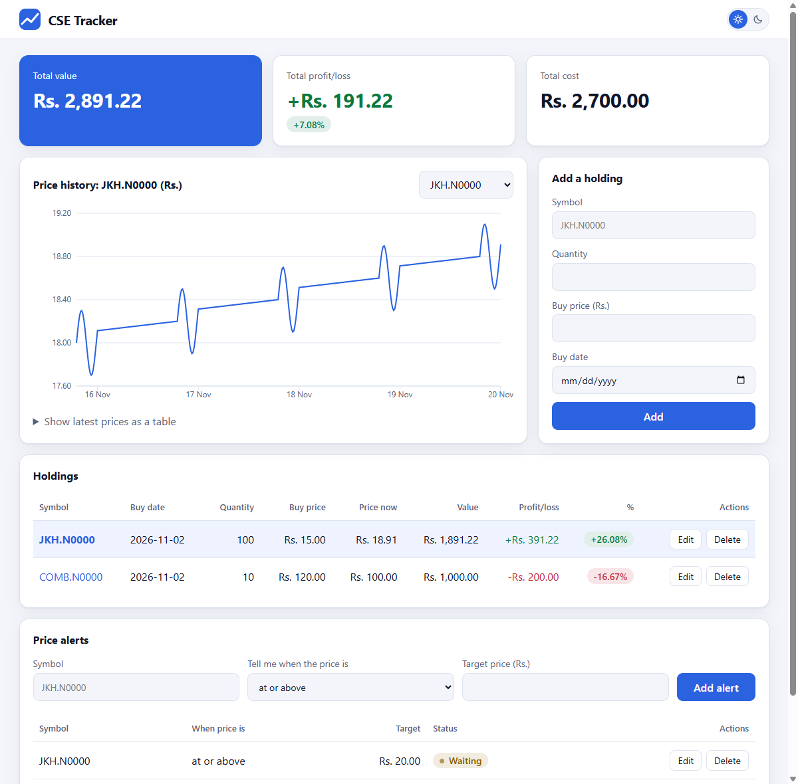
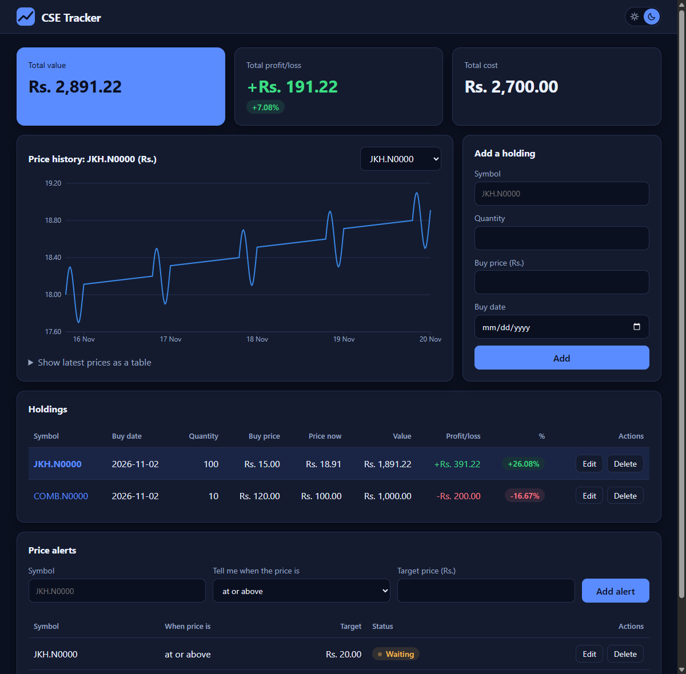
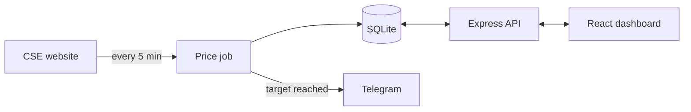

# CSE Tracker

A dashboard for tracking shares on the Colombo Stock Exchange (CSE). It fetches
prices on a schedule, works out profit and loss, and sends a Telegram message when
a price reaches a target.

I built it as a portfolio project while learning JavaScript.



<details>
<summary>Dark mode</summary>



</details>

The screenshots use sample data, not real prices.

## Features

- **Holdings:** add, edit and delete the shares you own.
- **Automatic prices:** fetched every 5 minutes during market hours (9:30-14:30
  Colombo time, Monday to Friday), when the server starts and when you add a share.
  If the computer slept through a fetch, it catches up after waking.
- **Profit and loss:** for each holding and for the whole portfolio.
- **Price history:** a line chart for each share.
- **Price alerts:** a Telegram message when a price reaches or passes your target.
  Each alert is marked as triggered once it is sent, so it isn't sent again.
- **Dashboard:** light and dark modes, toast messages, and a layout that works on phones.
  Animations turn off if your computer asks for reduced motion.

## Built with

| Part | Tools |
|---|---|
| Backend | Node.js, Express |
| Frontend | React, Vite, Recharts |
| Database | SQLite (better-sqlite3) |
| Scheduling | node-cron |
| Alerts | Telegram Bot API |

## How it works



The dashboard only talks to the Express server. Only the server contacts CSE.

## Getting started

You need [Node.js](https://nodejs.org) 22.12 or newer (built and tested with 22.14).

```bash
git clone https://github.com/YaSsien27/cse-tracker.git
cd cse-tracker
```

**1. Start the server** (http://localhost:3001)

```bash
cd server
npm install
npm run dev
```

**2. Start the dashboard** in a second terminal, from the main folder

```bash
cd client
npm install
npm run dev
```

Open http://localhost:5173 and add a holding, using a symbol such as `JKH.N0000`.
Its price appears within a few seconds. After that, it updates while the server runs
during market hours.

## Telegram alerts (optional)

Everything except alert messages works without this.

1. In Telegram, message **@BotFather**, send `/newbot`, and copy the token.
2. In `server`, copy `.env.example` to `.env` and fill in `TELEGRAM_BOT_TOKEN`.
   Git ignores `.env`, so the token stays private.
3. Open your new bot, press **Start**, and send it any message.
4. In `server`, run `npm run setup-telegram` and copy your chat ID into `.env` as
   `TELEGRAM_CHAT_ID`.
5. Run `npm run setup-telegram` again to get a test message, then restart the server.

## API

| Method | Address | What it does |
|---|---|---|
| GET | `/api/portfolio` | Holdings with profit/loss, and the total |
| GET | `/api/holdings` | List holdings |
| POST | `/api/holdings` | Add a holding |
| PUT | `/api/holdings/:id` | Edit a holding |
| DELETE | `/api/holdings/:id` | Delete a holding |
| GET | `/api/prices/:symbol` | Saved price history |
| GET | `/api/alerts` | List alerts |
| POST | `/api/alerts` | Create an alert |
| PUT | `/api/alerts/:id` | Edit an alert and set it back to waiting |
| DELETE | `/api/alerts/:id` | Delete an alert |

## Checks

In `server` (these don't contact CSE or Telegram, or touch your data):

```bash
npm run check-db
npm run check-job
npm run check-alerts
```

In `client`:

```bash
npm run lint
npm run build
```

## Project structure

```
server/
  index.js        starts the server and the price job
  apiRoutes.js    the API
  db.js           database tables and functions
  priceJob.js     decides when to fetch prices
  cseApi.js       fetches a price from CSE
  portfolio.js    profit and loss maths
  alerts.js       decides when an alert fires
  telegram.js     sends Telegram messages
client/src/
  App.jsx         puts the dashboard together
  api.js          talks to the server
  toast.js        the list of toast messages
  components/     cards, forms, table, chart and pop-ups
```

## Limitations

- It is made to run on your own computer. The API has no login, so don't put it on the
  internet as it is.
- Prices are only fetched while the server is running and the computer is awake.
- Prices can be about 5 minutes old, so quick changes between fetches can be missed.
- It doesn't know about Poya days and other market holidays.
- Broker fees and taxes are not included in profit and loss.
- A symbol is checked for its format, but not that it exists.

More ideas and known problems are in [NOTES.md](NOTES.md).

## About the data

CSE has no official public API. Prices come from unofficial endpoints used by
[cse.lk](https://www.cse.lk), which could change at any time. Please keep the
5-minute schedule so the site isn't overloaded.

This project is not connected to the Colombo Stock Exchange and is not financial advice.
